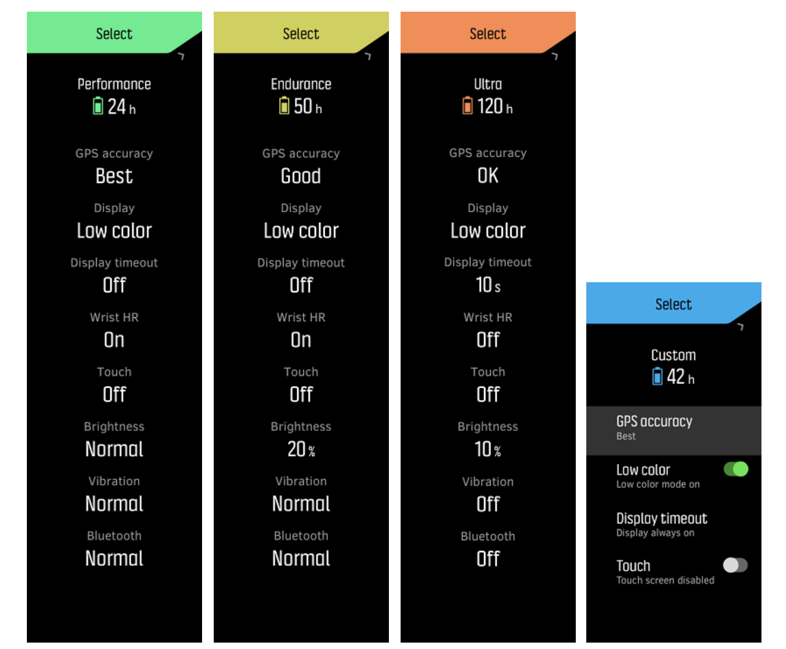
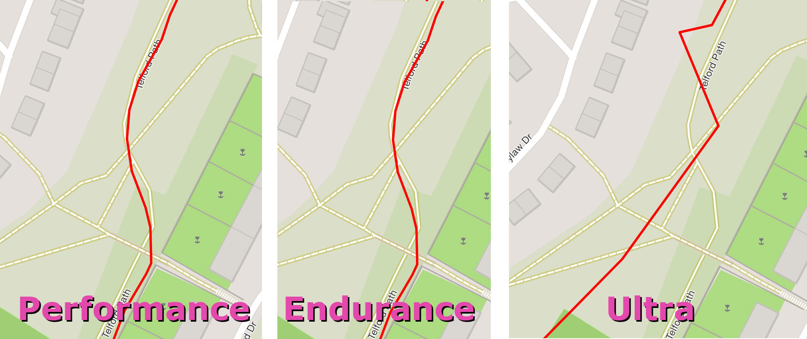

A brief comparison of the measurement precision of the different battery saving modes provided by in **Suunto 9**.

There is an excellent [description of battery modes on the Suunto website](https://www.suunto.com/en-gb/Support/faq-articles/suunto-9/how-do-i-get-the-most-out-of-the-battery-modes/)

The *tl;dr* is: You can significantly increase battery life by restricting some features and accuracy. My main point in this post is the advertised [FusedTrack](https://www.suunto.com/en-gb/Support/Product-support/suunto_9/suunto_9/features/fusedtrack/) technology that is described as follows:

> To save battery when exercising, some of the battery modes in Suunto 9 change the interval of the GPS readings. To avoid getting bad GPS tracking when exercising Suunto 9 uses FusedTrack. FusedTrack uses motion sensors to log your movement between the different GPS readings, which will provide better tracking of your exercise.
> 
> FusedTrack is activated automatically during running and trail running when Ultra or Endurance battery mode is chosen and it improves the tracking and distance accuracy between the GPS readings. Endurance mode uses a GPS reading interval of 1 minute and Ultra mode a GPS reading interval of 2 minutes.

## My test

I have an easy **~10 km** [loop behind the house](https://www.strava.com/routes/21594781) that is my go-to when I don't want to think too hard about my daily run. I went for a run using **Performance** mode, then with **Endurance** and finally using **Ultra** settings on my watch. My runs have been pretty consistent. And although I don't expect the pace to be the same, the distance should match pretty much perfectly:

| Mode | Distance | Distance diff [km] | Distance diff [%] |
| ---- | -------: | -----------------: | ----------------: |
| Performace | 9.28 km | N/A | N/A |
| Endurance | 9.32 km | +0.04 km | +0.431% |
| Ultra | 9.25 km | -0.03 km | -0.323% |

These results are surprisingly good. If I zoom on the map very close I will be able to see the different granularity of different modes:

## Problems with Strava import

Unfortunately at the time of writing this post, there is a bug in Suunto → Strava import that will render some data fields with incorrect values. Namely **moving time** and **average speed**. Curiously average speed of individual *segments* will be correct. I fixed this by editing the workout and selecting **Run type: Race**. Unfortunately for whatever reason, this did not fix **Strava matched runs** for me.

Here is a full explanation from **Strava** support:

> Unfortunately, this is an issue with how the activities are being recorded on the Suunto device. The original file contains numerous data errors that cause problems when they are pushed over to Strava. We are working with Suunto to resolve the issue on their end, we appreciate your patience. In the meantime, I have included two suggestions to try and get your data a bit closer.
> 
> Suggestion 1 - To swap your distance stream:
> 
> This will remove the outlier points from the device recording and rely on the GPS data instead.
> Click on the link directly below your current distance listed on the Activity Details page, where it says "Distance(?)" in small letters.
> From the pop-up, click "Correct Distance".
> When the status changes from "Calculating" to "Updated," refresh the page.
> If you would like to revert the change, you can click the same link and click "Revert Distance".
> 
> Suggestion 2 - Tag activity as a race: This will force the activity to read the total elapsed time instead of the inaccurate moving time.
> 
> Go to the edit screen for the activity in question
> Mark the activity as a Race.

## Verdict

The best part about this whole functionality is that you can change the tracking mode during the workout. Suunto even included a [nice touch](https://www.suunto.com/en-gb/Support/Product-support/suunto_9/suunto_9/features/battery-power-management/) when the watch during a workout running low on battery will actively advise you to change the tracking mode to make sure that you will have enough juice to record the whole route.

The advertised recording time of the **Performance** mode is **~24 hours**. These values are theoretical. I did not have a chance to test its limits, but so far **10 hours** of continuous tracking in *Performance* mode and I was far from running out of power. So I think the watch can do "reasonable" day activities pretty easily.
