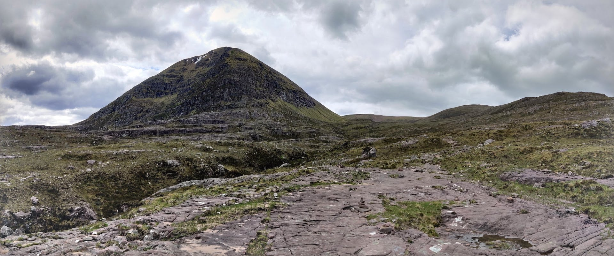
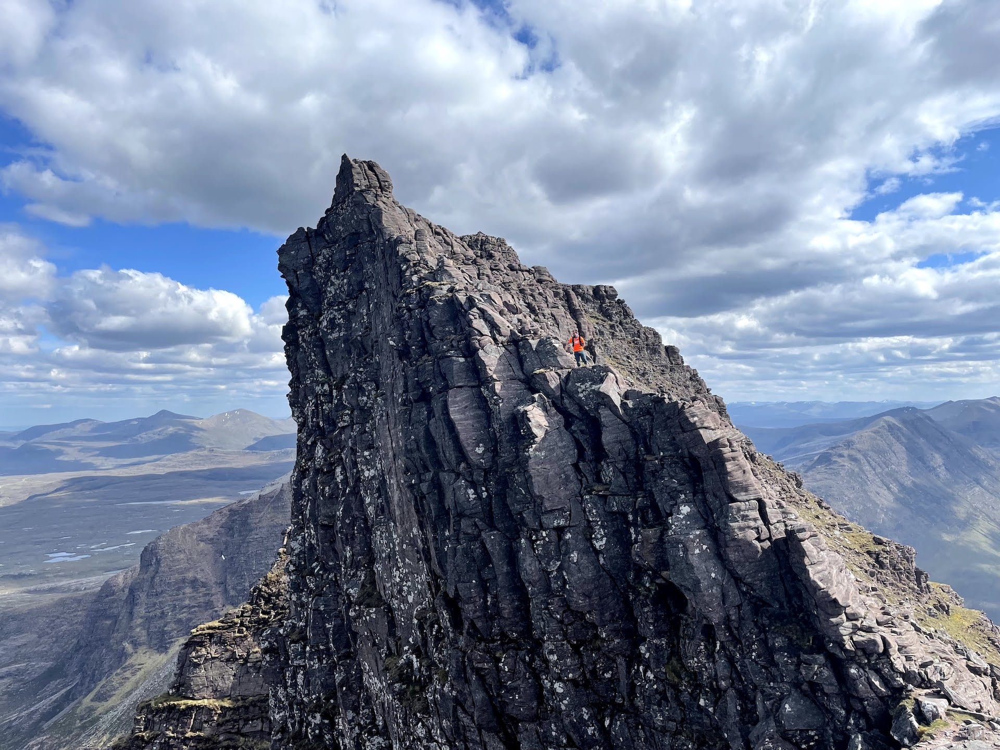
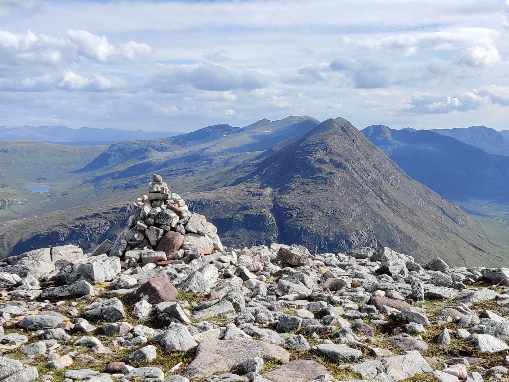
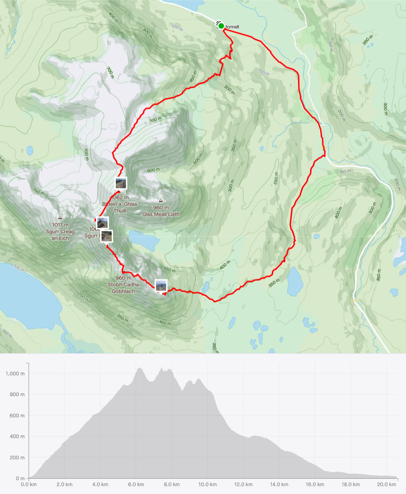

In Scotland there are a lot of positive stories about An Teallach. Beautiful views, bold scrambles, Michellin-like stone towers. And I'm happy to report that we've got all of that.

> This fabled mountain is perhaps the most impressive in Britain and gives a day of drama and views that will live in the memory forever. The full traverse is a magnificent scramble, whilst the two Munros can be reached by an easier there-and-back route. -walkhighlands.co.uk-

As we arrived at the parking spot, it could not go unnoticed that the mountain started right here and there. No long approach necessary. So in the first **5.3km** we gained **893m** of altitude, which equals to a gradient of **16.8%**. 

At first the paths were dry and obvious, but once we got to more rocky areas the guiding line on the ground disappeared.

First Munro of the day **Bidein a'Ghlas Thuill** was "somewhere on the left" from us and "the left" meant a massive uphill. We stayed low for a long time, but eventually we snaked our way up somehow, but thanks to that we lost the views on the other side of the hill. So I'd very much recommend gaining altitude _as soon as possible_.

The views from the first peak were worth every step of that massive incline.

Next was **Sgurr Fiona** which meant a little altitude dip and back up. On the way we met a couple of hikers with a very goodest boi 🐕. Fun thing was that one of them was Czech 🇨🇿.

Once we got to the top of **Fiona** we were offered amazing views on the even nicer part of the local mountains. On the right side **Loch na Seallga** with **Shenavall Bothy** next to it. A quick snack, snap some pictures, mandatory [geocache](https://www.geocaching.com/geocache/GC1RPFM_lord-berkeleys-repose?guid=b54d08ef-439c-44c7-bb1e-91bd9a9ec4f0) search and we're ready to move on.

From the top of **Sgurr Fiona** in the _South_ direction there are two possible paths:

1. One goes lower around the mountain. The terrain is extremely unstable and [scree](https://en.wikipedia.org/wiki/Scree) flows down the hill as you're trying to traverse.
2. The other one is on the top of the ridge and requires pretty significant [scrambling](https://en.wikipedia.org/wiki/Scrambling) skills. Brown underpants level of scrambling if you ask me. Doable if you have some climbing experience. Absolutely _not recommended_ if the conditions are even a _little bit wet_.

After we hit **Sail Liath** we turned sharp left and started quickly descending, which in retrospect was a big mistake. The hill is _very steep_ and mostly covered in _scree_. The gradient and size of the pebbles made the descend extremely annoying with limited possibilities for "scree surfing".

After that a quick jog through the forests on somewhat good paths, and some _2k_ on the road back to the car park.
## Conclusion

**An Teallach** definitelly stood up to its name. The views from the top are some of the most dramatic ones one can get in the Scottish Highlands. The whole route is pretty much guaranteed to be dry. If you're unsure about unstable terrain, this one might scare you a little bit, but I really think it's very much worth a go.
## Stats

- Distance: 20.63km
- Moving time: 5h 03min
- Elevation gain: 1,316m
- [Strava activity](https://www.strava.com/activities/5430832371)
- [An Teallach on walkhighlands.co.uk](https://www.walkhighlands.co.uk/ullapool/anteallach.shtml)
- [An Teallach parking](https://goo.gl/maps/YNkV2ew7gk4MyXWQ7) can get pretty busy: 57.840167218662415, -5.215196767640914
