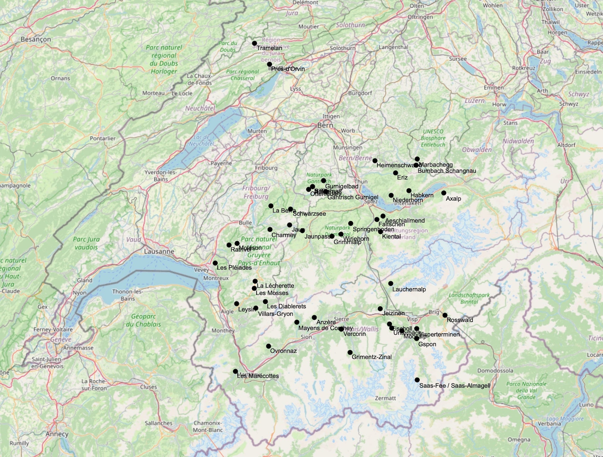

Swiss love their passes
that unlock a cheap access to places in nature.
And I love having a good overview
by having said places displayed in a [mapping app of my][1] choice.

For this year I decided to buy [Magic Pass][2],
which unlocks tons of travel destinations.
Sadly there is no **good** map
showing all the places of validity.

Luckily I'm a developer
and I can solve this.
So I created a [wee script that][3]
parses Magic Pass website for individual destinations
and then uses a [free Geocoding API][4]
to translate places names into GPS coordinates.

Up to date resulting GPX can be downloaded from [MagicPass2GPX project GitHub / Magic Pass.gpx][5].

## Screenshot

## Final notes

I'm happy to help out with similar projects,
in case you happen to have one in mind
feel free to contact me on:

- [Telegram / Signal / WhatsApp](tel:+41779554796)
- [Email](mailto:michal.bryxi@gmail.com)

[1]: https://www.locusmap.app
[2]: https://www.magicpass.ch
[3]: https://github.com/MichalBryxi/MagicPass2GPX
[4]: https://geocode.maps.co
[5]: https://github.com/MichalBryxi/MagicPass2GPX/blob/main/Magic%20Pass.gpx
