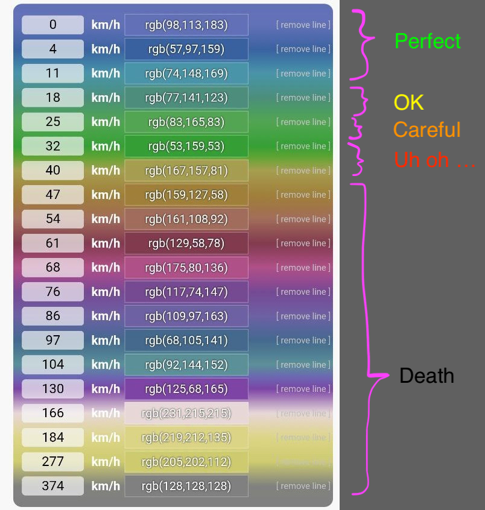
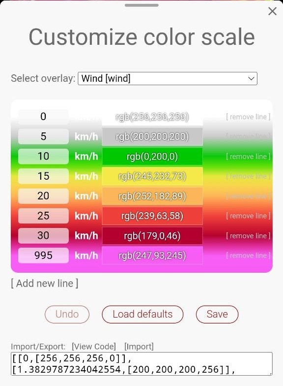
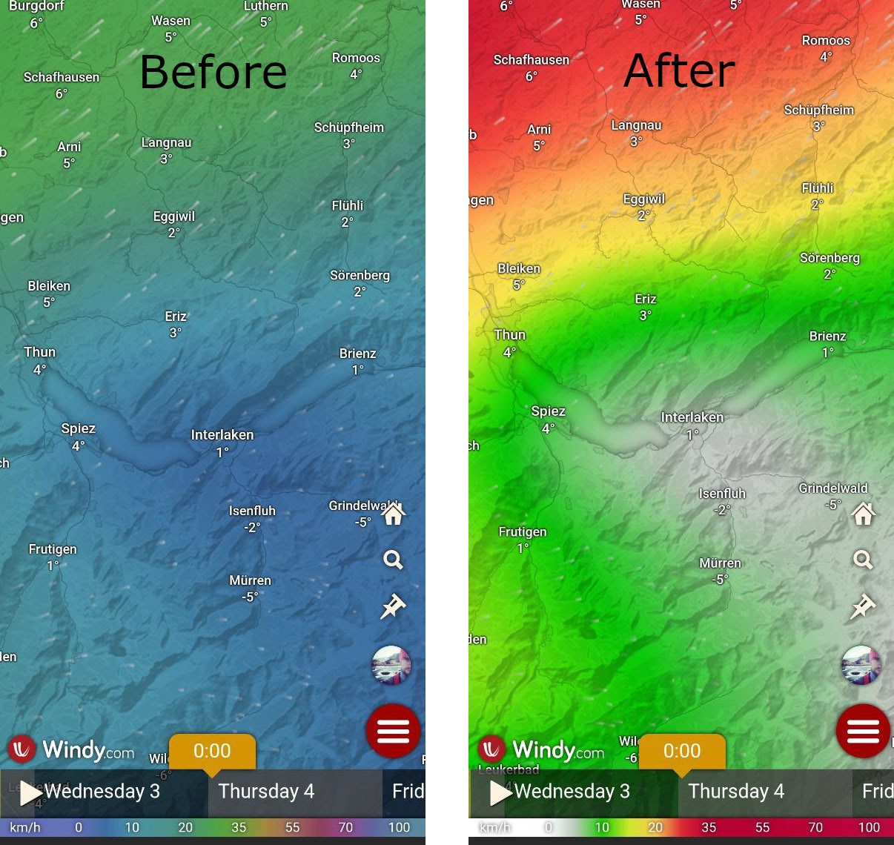

[Windy](https://play.google.com/store/apps/details?id=com.windyty.android&hl=de&gl=US) is a great application for weather forecast. Sadly the default heatmap colour coding for wind strength is borderline useless for *paragliding*, because the scale has too low of a resolution for non-lethal wind speeds.



So you end up with blue, little bit of green and everything else is not acceptable.

Luckily you can adjust the colour scale according to your likings.

## How to fix this

1. Open Windy
2. Hamburger menu
3. Settings
4. Customzie color scale
5. Select overlay -> `Wind [wind]`
6. `[View code]`
7. Replace the textbox content with:
```json
[[0,[256,256,256,0]],
[1.3829787234042554,[200,200,200,256]],
[2.765957446808511,[0,200,0,256]],
[4.1489361702127665,[245,232,73,256]],
[5.531914893617022,[252,182,89,256]],
[6.914893617021276,[239,63,58,256]],
[8.297872340425533,[179,0,46,256]],
[276.3191489361702,[247,93,245,256]]]
```
8. `[Import]`
9. Save

After this you should see the scale like this:



And now when we put those two side-by-side we can see the colour scale on the right side more useful for the wind speeds paragliders usually tend to operate at. Instead of big pretty much only blue area in the South we can see that the South-East will be very calm, while South-West will be tiny bit windy. And at the same time instead of friendly green North side on the left we can see quite the colours quite quickly turning yellow, organge, red on the right.


