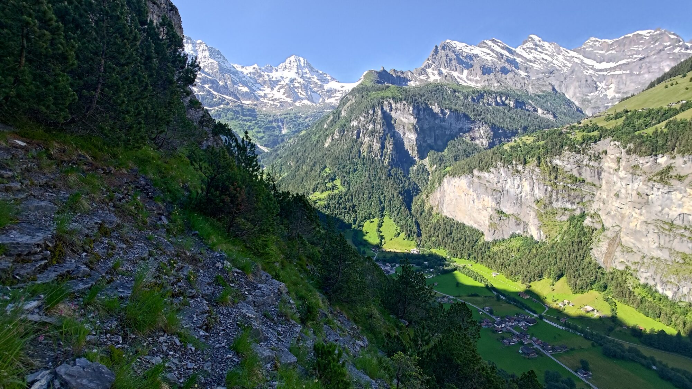
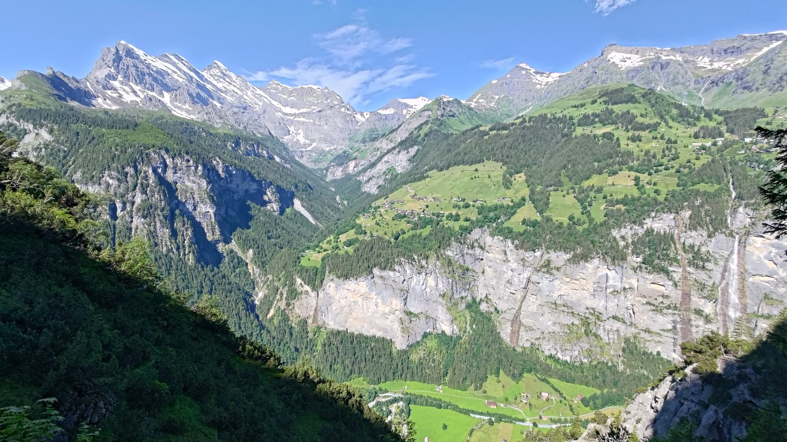
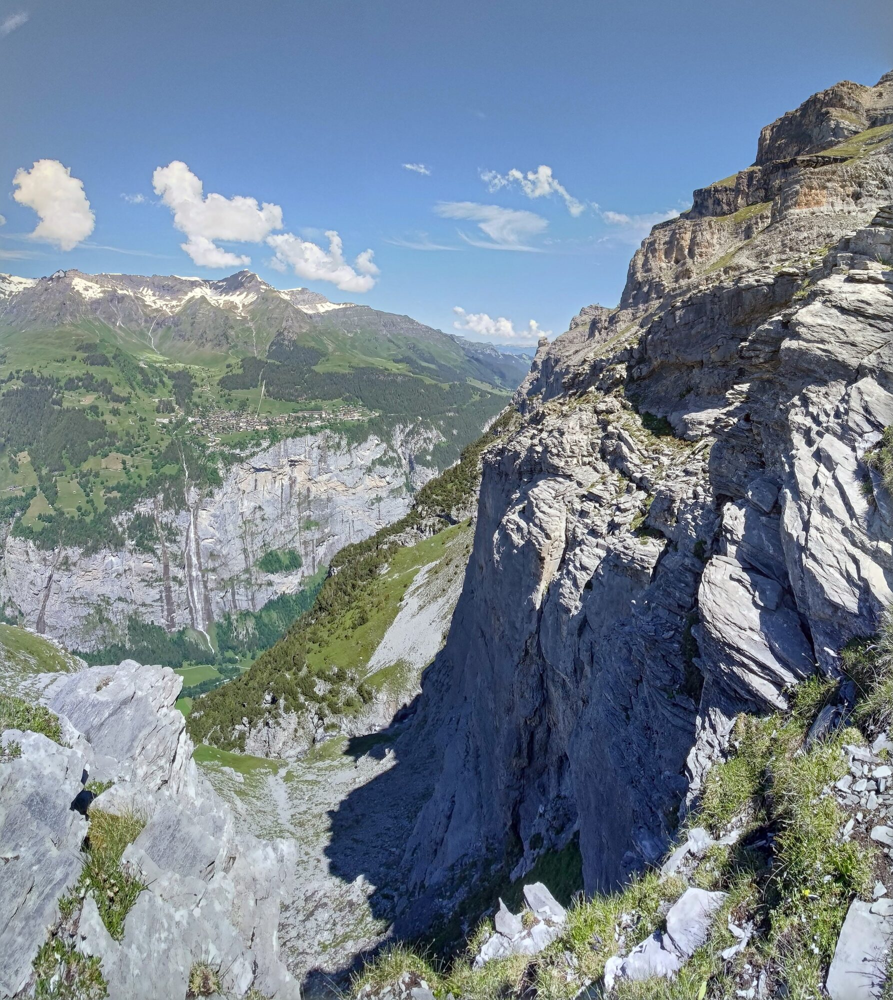
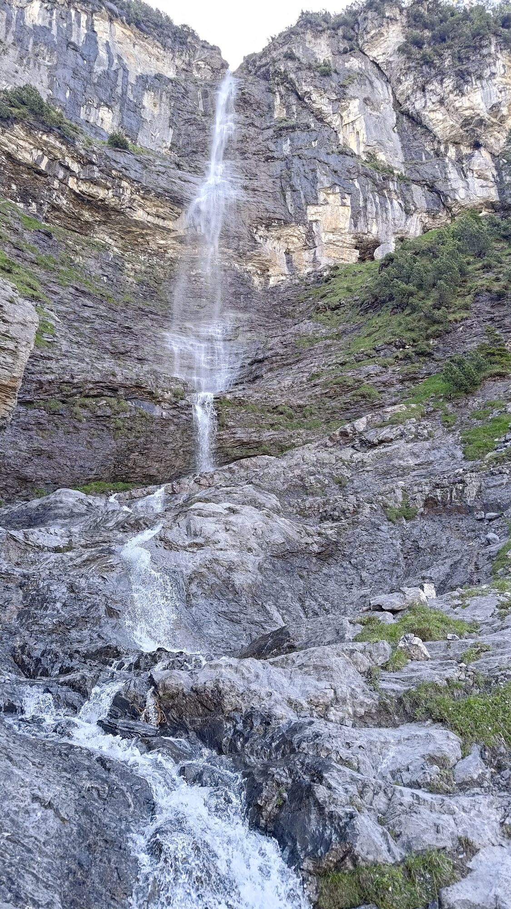
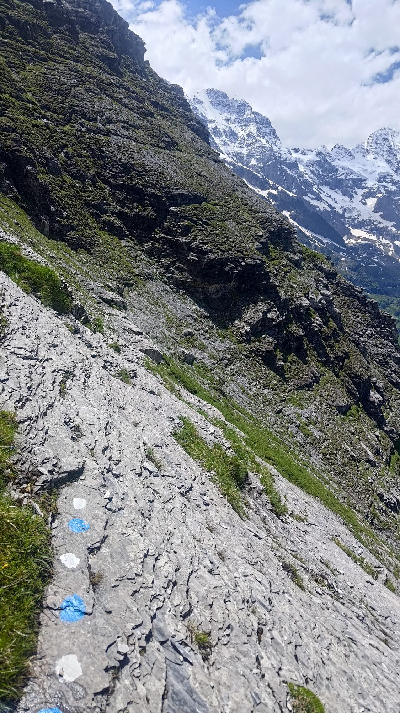
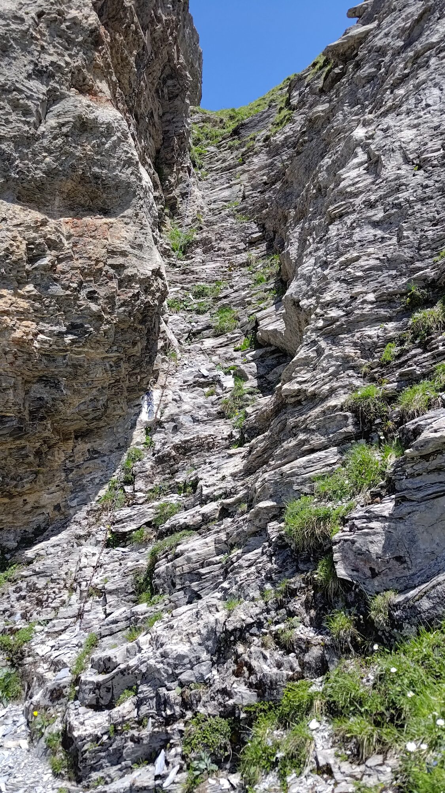
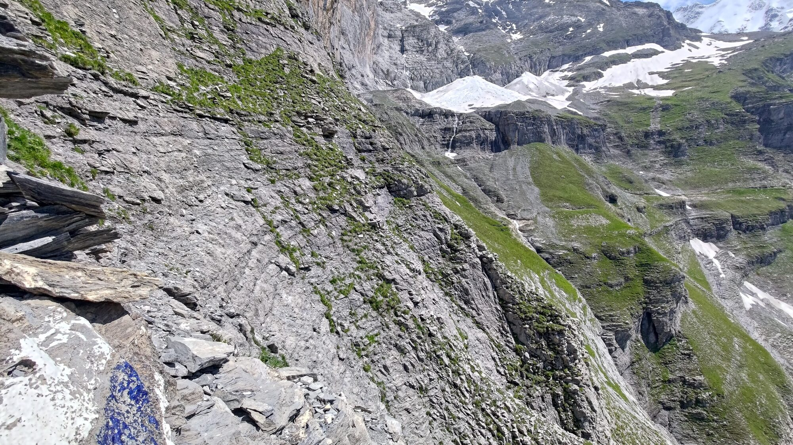
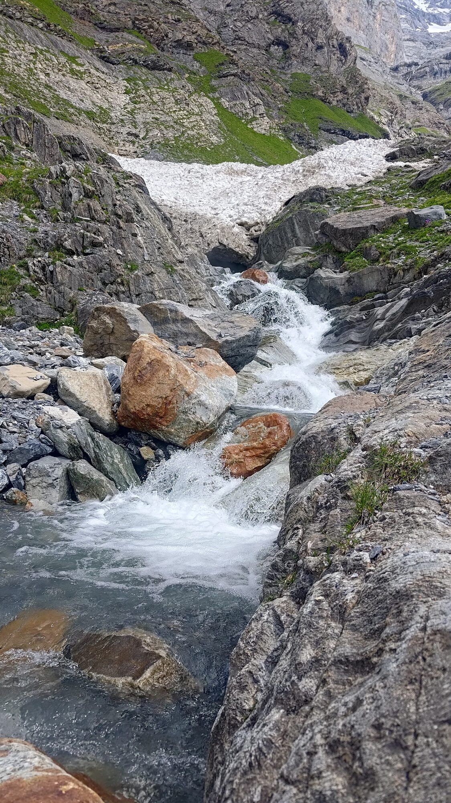

*The T6 that taught me what “mandatory” means.*

## The facts

| Name | Value |
|------|-------|
| Date | 25 June 2024 |
| SAC route | [Von Stechelberg über das Katzenwegli](https://www.sac-cas.ch/en/huts-and-tours/sac-route-portal/silberhornhuette-sac-2147000249/mountain-hiking/von-stechelberg-ueber-das-katzenwegli-6805/) |
| Grade | [T6](https://de.wikipedia.org/wiki/SAC-Wanderskala) |
| Start / finish | [Stechelberg](https://en.wikipedia.org/wiki/Stechelberg), 910 m |
| Destination | [Silberhornhütte](https://www.sac-cas.ch/en/huts-and-tours/sac-route-portal/silberhornhuette-sac-2147000249/), 2663 m (turned back at ~2650 m) |
| Distance | 13.8 km |
| Ascent | ~1820 m |
| Duration | 5 h 36 min ([Strava](https://www.strava.com/activities/11735388468)) |
| Conditions | unexpected snow above ~2450 m |
| Gear | microspikes; no ice axe (mistake ⚠️); no rope |

## The story

### Going up

The first part zigzags steeply up through forest, past a waterfall and over debris. The pathfinding isn't fun, but it goes. Then the route runs under the rock face, where occasional red dots mark the way. That's unusual for a T6.

The first crux is a big, steep scree field. Anything coming from above would hit me, and a slip would send me off the cliff below. I crossed it carefully. It wasn't nice, but I could still have turned back.

The second crux is a traverse across a dried-out waterfall, with a few bolts in the rock for anyone carrying a rope. I didn't have one. I tried a few moves, then committed to one that was well beyond what was reasonable: pulling myself sideways across a slab of rock that might have been crumbly, with nothing to hold onto, to reach the remains of the path on the other side.

Once across, I realised I could not reverse that move. From here it would either go, or end with a helicopter. What kept me going was knowing that the T6 joins a T5 higher up. Finish the hard bit, and it's just a moderately easy walk off. At least that's what I thought.

Above the waterfall the terrain eased into grass and a bit of scree, up to the big boulder basin below the hut. Then came the thing I did not expect at the end of June: about 200 vertical metres through a solid layer of snow, all the way up to the point where my T6 joined the T5 I'd planned to descend.

I found some dry rocks, sat down and planned the descent. Scared by the snow, my slow progress and the unknown snowfields ahead, I did not go on to the hut that day.

### Coming down

The way down crossed a long, steep snowfield that bent round a corner, with old footsteps leading in. It was the only way, so I went.

The footsteps faded, and it got scary. I had microspikes but no ice axe. My feet were fine, but I had nothing for my hands and no way to stop a slide. I kicked deep steps and crept along a slope that felt like 45°, with a 200 m drop below. I was also thinking about avalanches, because it's not only you that has to stay on the mountain, the snow has to as well.

I didn't call [Rega](https://www.rega.ch/en). I was sure it would go, and it did. Looking back, that was luck, not judgement.

Round the corner the slope eased onto bare rock, and the rest was easy: a few chains, a gorge, some stream hopping.

About 5½ hours up and 2–3 down. Very happy to be off it. Proper [type 3 fun](https://www.rei.com/blog/climb/fun-scale).

## What I take on a T6 now

1. **Microspikes. Always.** They weigh nothing, and when you need them, nothing else will do.
2. **An ice axe.** I still leave it at home too often. On steep snow, and on steep grass, it's the difference between a slip and a fall.
3. **A few slings or a short rope.** Enough to improvise a harness, use a boulder as an anchor, or leave a bit of tat in a nasty spot for whoever comes next.
4. **A way to call for help.** A satellite messenger like [Garmin inReach](https://www.garmin.com/en-US/c/outdoor-recreation/satellite-communicators/), or a phone with [satellite SOS](https://support.apple.com/en-us/101573). The inReach is tougher, has its own battery, and can share your location even if you can't.
5. **A plan someone else knows.** "I should have signal by 3 pm. If you haven't heard from me, check on me."
6. **Dry, stable weather.** If it rained the day before, or today's forecast is shaky, I don't go. This should really be rule number one.

I've had a few epics and some genuinely bad days out there, and these rules came from them. Mountains aren't a playground, and nobody's mum is coming to pick you up when it gets too scary.

## The route

<iframe src="https://map.geo.admin.ch/#/embed?lang=en&center=2636753,1155689&z=6.5&bgLayer=ch.swisstopo.pixelkarte-farbe&layers=KML%7Chttps://adventuring-misa.pudr.com/gpx/2026-11-15-katzenwegli-t6.kml" style="border: 0; width: 100%; height: 450px;" allow="geolocation" title="Katzenwegli route on the swisstopo map"></iframe>

[Download the GPX](/gpx/2026-11-15-katzenwegli-t6.gpx) · [Open in the swisstopo map](https://map.geo.admin.ch/#/map?lang=en&center=2636753,1155689&z=6.5&bgLayer=ch.swisstopo.pixelkarte-farbe&layers=KML%7Chttps://adventuring-misa.pudr.com/gpx/2026-11-15-katzenwegli-t6.kml) · [SAC route description](https://www.sac-cas.ch/en/huts-and-tours/sac-route-portal/silberhornhuette-sac-2147000249/mountain-hiking/von-stechelberg-ueber-das-katzenwegli-6805/)
